# HolyArrs for Apple Vision Pro, Apple TV, iPhone and iPad

A native SwiftUI client for [HolyArrs](https://github.com/HolyArrs/HolyArrs), the self-hosted all-in-one replacement for Sonarr, Radarr, Prowlarr and Seerr. One app, built for **visionOS**, **tvOS** and **iOS/iPadOS** from the same code: browse and discover, ask for movies and shows, approve requests, watch downloads, and **play your library through Jellyfin** with resume, subtitles and next-episode autoplay.

Not affiliated with the HolyArrs project.

| Apple Vision Pro | Apple TV |
|---|---|
| 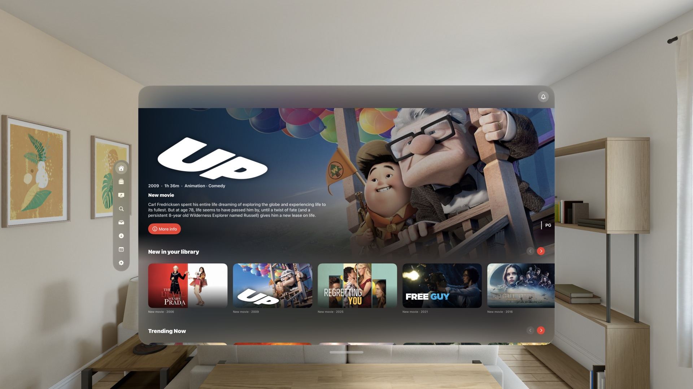 | 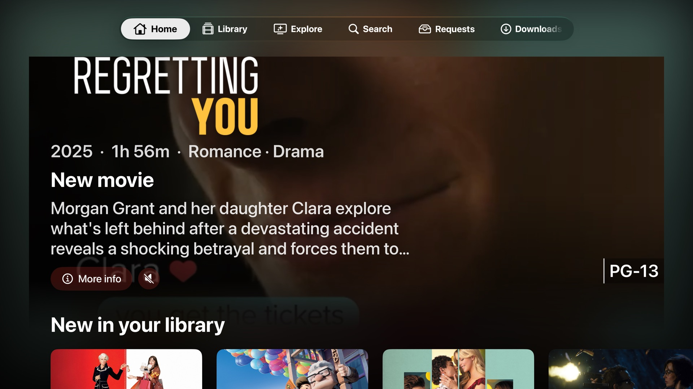 |
| 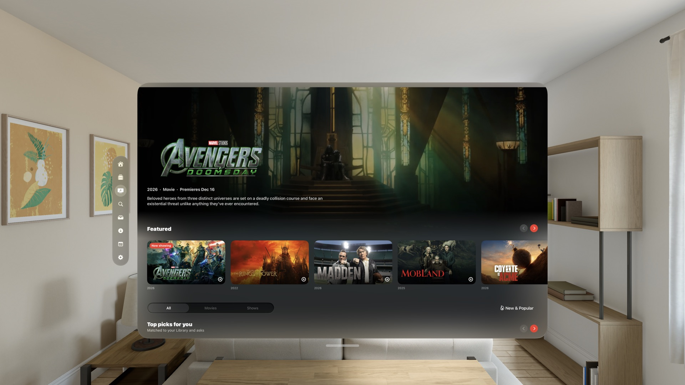 | 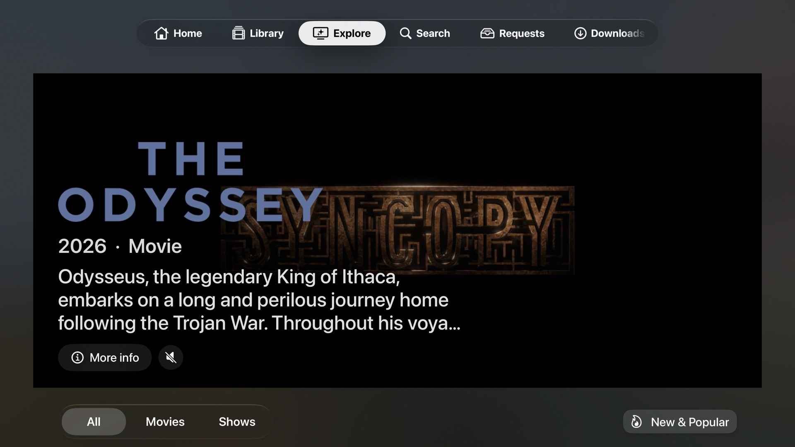 |
| 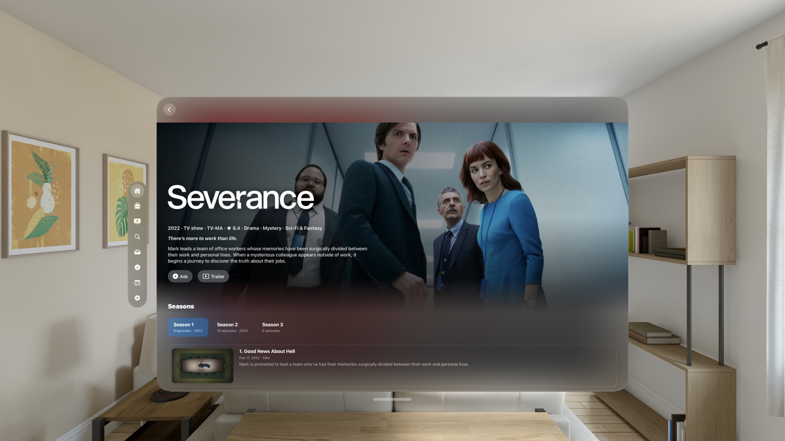 | 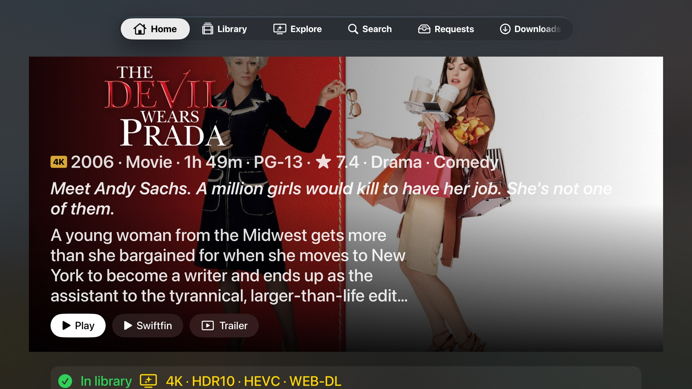 |
| 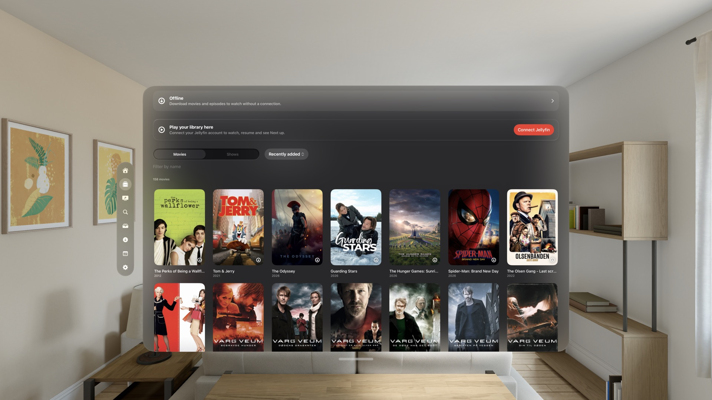 | 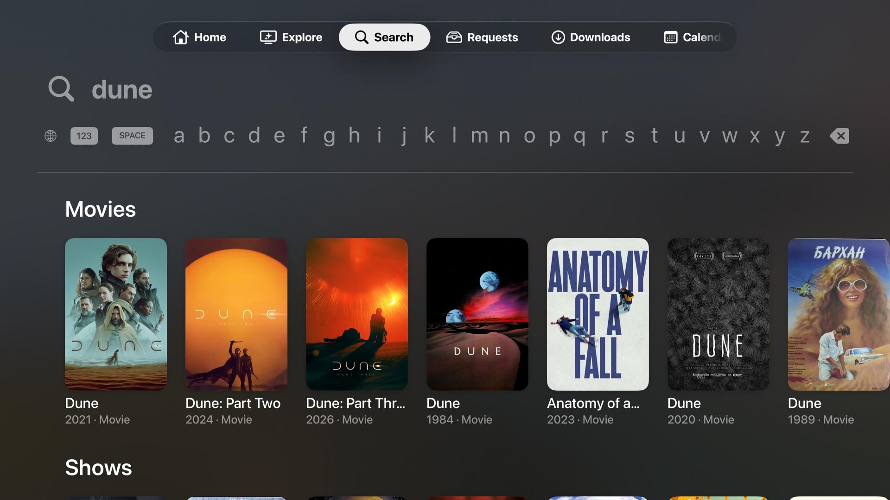 |

| iPhone | | | |
|---|---|---|---|
| 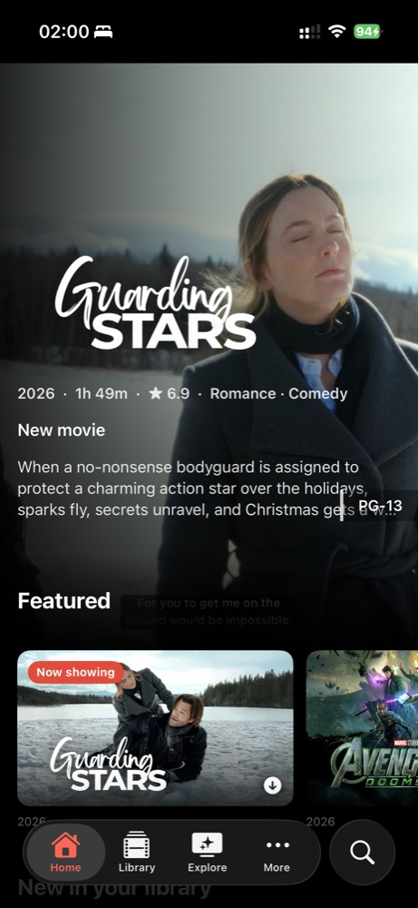 | 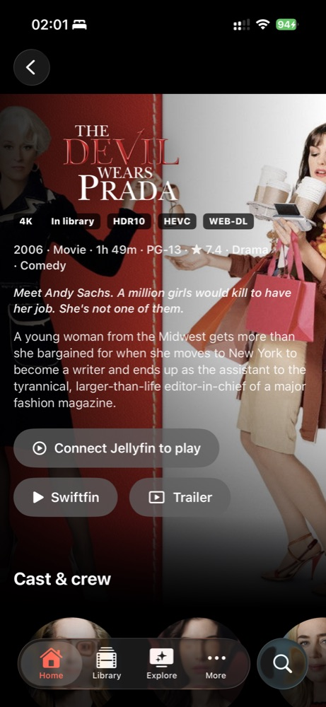 | 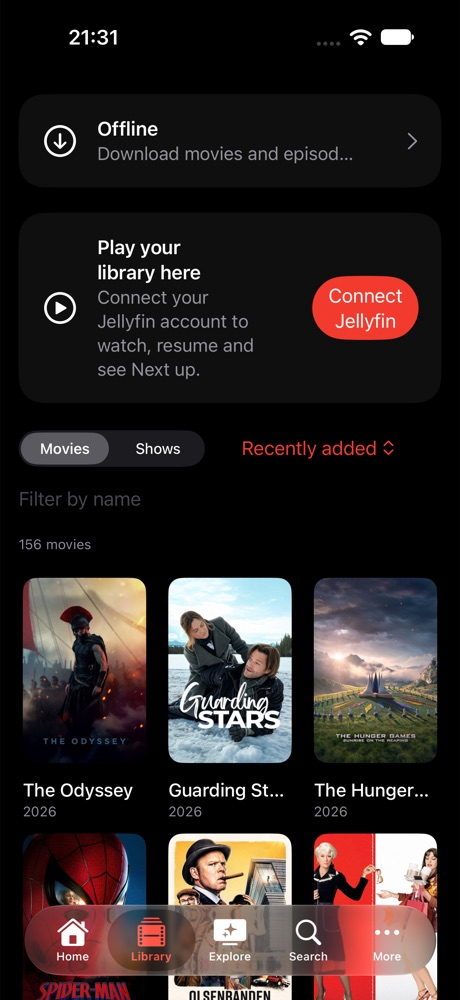 | 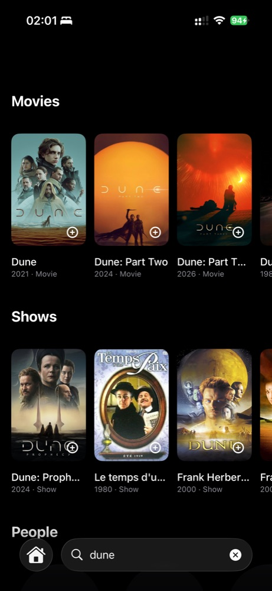 |

## Features

- **Home**: a featured billboard (a recent arrival with its logo, headline, overview, rating and a muted trailer preview), then rows of landscape logo tiles: Continue Watching and Next Up with progress bars (one click plays), New in your library, Trending Now, New seasons, Following and Coming soon, plus your requests, approvals and library totals.
- **Library**: Continue watching and Next up from Jellyfin (one click plays), then every movie and show in HolyArrs with sort and filter. 4K / FHD / HD / SD marks on everything you have.
- **Explore**: a full-bleed billboard with a muted trailer preview, your personal rows, browse by genre and category, and New & Popular with top-10 rows.
- **Search**: your library first, then TMDB movies, shows and people.
- **Title pages**: trailer billboard, Play / Resume (or the next episode), Swiftfin hand-off, trailer with sound, file quality (resolution, HDR, codec), seasons with per-episode play and progress, cast, collection and similar titles. Ask for a movie or a show (whole show, chosen seasons, or new episodes only).
- **People**: biography, known for, what is in your library, filmography.
- **Requests**: filter by state, approve, turn down with a note, remove.
- **Downloads**: live list (refreshes every 3 seconds while visible) with progress, speed and ETA; pause, resume, remove; Decide (needs a decision, confirm match), History and Turned down.
- **Calendar**: upcoming episodes and movie dates as cards, grouped by day.
- **Settings**: server, account, Jellyfin connection, autoplay toggles, sign out.
- **Offline** (Vision Pro, iPhone, iPad): download movies, episodes or whole seasons from Jellyfin (Original, High 1080p or Medium 720p) with subtitles, in the background. The Offline page lists them by show with storage use, delete and Remove watched, and plays them without a connection. Watch positions made offline go to Jellyfin when the server is back. When HolyArrs cannot be reached at launch the app opens on the Offline page and keeps your login.

### Design

- Cinema-dark look with HolyArrs red as the accent.
- Ambient backdrop: a blurred, tinted picture of the current title behind every page (it follows focus on Apple TV).
- Full-bleed billboards with muted, looping trailer previews (Settings can turn previews off).
- Rows of landscape tiles with title logos, 4K / FHD / HD / SD marks and status badges.

### Platform design

- **visionOS cinema theatre** ([screenshot](Docs/screenshots/visionos-theater.jpg)): library playback opens an immersive cinema hall (dark walls, curtains, rising rows of seats, aisle lights) and docks the player onto a 14 m screen in front of your front-row seat; it closes with the player. Turn it off in Settings › Cinema theatre when playing.
- **visionOS**: tab ornament, a custom dark window, gaze highlight on every card and row, row arrows and draggable scroll bars for mouse and trackpad, full-window player that docks in environments.
- **tvOS**: top tab bar, focus-driven card buttons, large type, the standard tvOS player; the backdrop follows focus.
- **iOS / iPadOS**: tab bar on iPhone, sidebar or top tabs on iPad, compact cards on iPhone, full-screen player with Picture in Picture.

### Playback

HolyArrs manages the library; Jellyfin streams it. The app asks Jellyfin for PlaybackInfo with a device profile made for Apple's player:

- MP4/MOV with H.264 or HEVC plays directly.
- Everything else (MKV, DTS, TrueHD, ...) comes as fragmented-MP4 HLS, with the video copied when possible (4K HDR/Dolby Vision HEVC stays untouched) and the audio converted to AAC/AC-3/E-AC-3.
- Text subtitles arrive as WebVTT HLS renditions you pick in the player; picture subtitles (PGS) are burned in.
- Playback start, progress and stop are reported to Jellyfin, so resume works across apps, and the transcode is ended when you close the player.
- Episodes roll on to the next one when they end.

Trailers play in the same player from the stream HolyArrs already resolved (`/api/v1/trailer`), and fall back to YouTube when HolyArrs has none.

## Requirements

- Xcode 26 or newer, [XcodeGen](https://github.com/yonaskolb/XcodeGen) (`brew install xcodegen`)
- visionOS 26, tvOS 26 or iOS/iPadOS 26
- HolyArrs 1.2 or newer, reachable from the device (for example over Tailscale with HTTPS)
- Optional: Jellyfin 10.10+ for playback

### Server notes

- **Sign-in host names.** HolyArrs refuses password and Jellyfin sign-in (and changes made with that sign-in) from host names it does not know. If you reach it as `https://holyarrs.example.ts.net`, add that name to `HOLYARRS_ALLOWED_HOSTS` in the HolyArrs container (comma-separated) or under Settings › Sign-in and security › Allowed host names, opened at its local address. API keys are not affected.
- **Ways to sign in.** HolyArrs account, Jellyfin account (one sign-in for HolyArrs and playback), or an API key (Settings › Sign-in and security › API keys). Two-factor codes are supported.
- **Playback** needs the app connected to Jellyfin: "Sign in with Jellyfin" does it, or Settings › Connect Jellyfin when you signed in another way.

## Build

```bash
brew install xcodegen
git clone https://github.com/mathiash98/holyarrs-apple.git
cd holyarrs-apple

# Your signing team and a bundle id you own (this file is git-ignored)
cat > Config/Local.xcconfig <<'CFG'
DEVELOPMENT_TEAM = ABCDE12345
HOLYARRS_BUNDLE_ID = com.yourname.holyarrs
CFG

xcodegen generate
open HolyArrs.xcodeproj
```

Your team id is in Xcode › Settings › Accounts, or at developer.apple.com › Membership. A free Apple ID works, but apps signed with it expire after 7 days; a paid developer account gives a year.

Pick the **HolyArrs** scheme, choose an Apple Vision Pro, Apple TV, iPhone or iPad destination (device or simulator) and press Run. The same target builds for all four.

## Install on Apple Vision Pro

1. On the headset: Settings › General › Remote Devices, and keep that screen open.
2. On the Mac: Xcode › Window › Devices and Simulators, select the Vision Pro and click **Pair**, then enter the code shown in the headset.
3. When asked, turn on Developer Mode on the headset (Settings › Privacy & Security › Developer Mode) and restart it.
4. Choose the Vision Pro as the run destination and press Run, or from the terminal:

   ```bash
   xcrun devicectl list devices          # find the device's UDID
   scripts/device-install.sh <udid>      # Release build, signed, installed
   ```

## Install on iPhone or iPad

1. Connect the device with a cable (or pair it over Wi-Fi in Xcode › Devices and Simulators) and trust the Mac.
2. Turn on Developer Mode (Settings › Privacy & Security › Developer Mode) when asked, and restart.
3. Choose the device as the run destination and press Run, or use `scripts/device-install.sh <udid>`.

## Install on Apple TV

1. On the Apple TV: Settings › Remote App and Devices, and keep that screen open (the Mac and the TV must be on the same network).
2. On the Mac: Xcode › Window › Devices and Simulators, select the Apple TV and click **Pair**, then enter the code shown on the TV.
3. Turn on Developer Mode on the Apple TV (Settings › Privacy & Security › Developer Mode) if Xcode asks for it.
4. Choose the Apple TV as the run destination and press Run, or use `scripts/device-install.sh <udid>`.

Then open HolyArrs, enter your server address and sign in.

## Development

| Script | What it does |
|---|---|
| `scripts/device-install.sh <udid>` | Release build for a paired Vision Pro, Apple TV, iPhone or iPad, and install. Uses `ASC_KEY_ID` / `ASC_ISSUER_ID` / `ASC_KEY_PATH` (App Store Connect API key) when set, otherwise your Xcode account. |
| `scripts/sim-run.sh <visionos\|tvos\|ios> [tab] [route] [search]` | Installs the DEBUG simulator build and launches it signed in with an API key. |
| `scripts/sim-shots.sh <visionos\|tvos\|ios> <dir> name:tab[:route[:search]] ...` | A screenshot per page. |
| `scripts/make-icons.py` | Regenerates the layered app icons from the HolyArrs mark. |

Put personal values for the scripts in `scripts/local.env` (git-ignored), for example:

```bash
HOLYARRS_SERVER=https://holyarrs.example.ts.net
HOLYARRS_KEYCHAIN_SERVICE=my-holyarrs-key   # or HOLYARRS_API_KEY=...
JELLYFIN_SERVER=https://jellyfin.example.ts.net
```

The simulator hooks exist only in DEBUG builds: the API key is kept in memory (never in the Keychain) and the app refuses every change while it is in use, so exploring a live server is safe. `HOLYARRS_TAB` (home, library, explore, search, requests, downloads, calendar, settings) and `HOLYARRS_OPEN` (`title/movie/<tmdb>`, `library/<id>`, `person/<id>`, `popular`, ...) open a page for screenshots.

### Layout

```
HolyArrs/
  App/        entry point and tabs
  Core/       API client, sign-in state, Keychain, image loader, routes
  Models/     tolerant Codable models for /api/v1
  Playback/   Jellyfin client, player, trailer previews
  Offline/    downloads, offline catalogue and player, offline launch
  Views/      one shared SwiftUI view per page
Config/       build settings (Local.xcconfig is yours)
Docs/         openapi.json from HolyArrs and screenshots
```

## Roadmap

- Library management pages (versions, files, rename, move), stats and music.
- Health checks and every settings page.
- Audio track choice before playback; Top Shelf content on Apple TV.

## License

MIT, see [LICENSE](LICENSE). `Docs/openapi.json` is generated by HolyArrs and is part of that project (AGPL-3.0). HolyArrs, Jellyfin, Swiftfin and TMDB are their owners' projects and trademarks.
